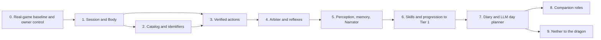

# Implementation Plan

What actually happened in each phase (events, fixes, decisions) is recorded in the [Implementation log](Implementation%20log.md).

This plan turns [Minecraft AI bot architecture](Minecraft%20AI%20bot%20architecture.md) into ten phases, from Phase 0 to Phase 9. Each phase ends in something you can **see working in your own game**, so the bot stays playable the whole way and no phase is a "big bang" rewrite. The order follows the layer dependencies: safety and control first, then the body and the identifiers, then verified actions and one arbiter, then memory, skills and progression, and only then the LLM planner, the roles and the late game.

**Ground rules for every phase**
- **Test in the real game.** You run your world (Minecraft 26.1 or older, because mineflayer 4.39 stops at 26.1) and the bot connects to it. Each phase lists the in-game checks that prove it is done.
- **Keep it shippable.** Each phase lands as small commits on `master`, and the bot keeps working between them. Large moves go to a short-lived branch first.
- **Respect the settled design.** The LLM plans; code acts. There is one bot instance, owner-only control, `bot.chat` for reporting, and a budget of about $10/month.
- **Cleanup happens inside the phase that touches the code**, not as a separate rewrite.

Phases 8 and 9 both build on Phase 7 and can run in either order, or interleaved.

| Phase | Goal in one line | Size |
|---|---|---|
| 0 | The bot obeys only you, in your real world, and stop always works | S |
| 1 | One object owns the connection; reconnects leave no stale state; it remembers recent chat and its death spot | M |
| 2 | Item and block names are validated and categorised in one place | M |
| 3 | No action reports success unless the server agrees | M |
| 4 | One arbiter decides what runs; reflexes and commands stop fighting | L |
| 5 | The bot remembers places and chests and speaks through one outbox | M |
| 6 | From a fresh spawn, the bot reaches "Tier 1 survival" alone, without the LLM | L |
| 7 | The LLM plans each day from the bot's diary | L |
| 8 | Farmer, guard, miner, hauler, builder and friend roles | L |
| 9 | The bot can finish the game: Nether, stronghold, dragon | XL |

Sizes are relative effort (S < M < L < XL), not calendar estimates.

---

## Phase 0: Real-game baseline and owner control

**Goal.** The bot runs reliably in your own game, listens only to you, and "stop" works even when OpenAI is down. The known defects are confirmed and fixed before anything is built on top of them.

**Deliverable (done when).**
- The bot joins your world, version 26.1 or older, with the right login mode.
- It ignores every other player's chat.
- "stop", "come", "follow me" and "status" work instantly with the internet unplugged.
- The four suspected bugs are confirmed or ruled out, and fixed.
- There is a written test checklist you can repeat after every phase.

**Actions**
1. **Decide how the bot joins your game.**
   - Pin your world to Minecraft 26.1 or older.
   - Choose a local server with `online-mode=false`, or a LAN world plus a login method. Add an `auth` setting (`offline` or `microsoft`) to the connection options; today none is passed, so the bot assumes an offline-mode server.
2. **Validate the config.** Read the `.env` settings through one Zod schema: `OWNER_USERNAME`, `SERVER_HOST`, `SERVER_PORT`, `AUTH`, `BOT_USERNAME`, `OPENAI_API_KEY`. Fail loudly at startup when a value is missing or wrong. Delete the unused `botConfig.json`, or fold it into this schema.
3. **Owner-only chat.** The chat handler ignores everyone except `OWNER_USERNAME`. Whispers from the owner count as owner chat. Note in the README that on offline-mode servers names are not authenticated.
4. **Stop interrupting on every chat line.** Remove the `pathfinder.stop()` that currently runs for any message.
5. **Fast path without the LLM.** Plain code parses `stop`, `come`, `follow me` and `status`/`what are you doing` before any API call. "Stop" must never depend on the network.
6. **Owner commands don't survive a restart.** Clear queued one-off commands at startup, which also removes today's stale `craftStoneTools`. Remembered knowledge (base, chests) stays.
7. **Confirm and fix the four suspected bugs:**
   - **`Unstack` busy loop:** `while (true)` with an `__actionsDelay(1000)` that isn't awaited ([Unstack.ts](../src/commands/Unstack.ts)).
   - **Unknown names become ID 0 (air):** `collectBlock("iron")` likely searches for air ([minecraftData.ts](../src/utils/minecraftData.ts)).
   - **Endless retry:** the re-queue is dropped as a duplicate and the failed command is never removed ([actionManager.ts](../src/managers/actionManager.ts), [persistenceManager.ts](../src/managers/persistenceManager.ts)).
   - **`breath` triggers `respawn()`** ([index.ts](../src/index.ts)).
8. **Write the test checklist** (`docs/real-game-checklist.md`): connect, owner-only, fast path, gather wood, craft tools, stop mid-task, reconnect after a server restart.
   - Optional: a tester bot (the one used during the upgrade) for scripted chat scenarios, run against your world.

**In-game check.** A second account's chat is ignored. "stop" works with Wi-Fi off. "unstack" no longer freezes the bot.

---

## Phase 1: Session and Body (L7)

**Goal.** One place owns the connection to mineflayer. Everything that should outlive a reconnect lives in a process-wide **Session**. Everything tied to one connection lives in a **Body** that is rebuilt on reconnect.

**Deliverable (done when).**
- The Body owns the connection. Every per-connection listener, timer and plugin is registered through it and cleaned up when the connection ends. Plugins are reached only through `core/plugins`.
- Calls that change the game don't spread. A boundary check (`scripts/checkBoundaries.ts`) freezes today's direct calls per file and fails on new ones.
  - Phase 3 moves these calls into checked primitives; Phase 4 puts those primitives behind leases.
  - Reads (position, inventory, blocks) stay direct reads of the one bot.
  - *Reworded 2026-11-24.* The original "all `bot.*` calls go through the Body adapter" would have meant wrapping about 365 reads for no gain, and wrapping the game-changing calls twice. See the [Implementation log](Implementation%20log.md), entry 5.
- After a server restart, the bot comes back with clean state: no leftover health tracking, timers or listeners from the old connection.
- **Its death spot and your last known position survive a bot restart**, so death recovery and "come here" still work after it restarts.
- **It remembers the recent conversation**, so follow-ups like "do that again", "no, the other one" or "let's start from the beginning" make sense to it.
- Behaviour is otherwise unchanged.

**Actions**
1. **Create `Session`**, a singleton holding config, the goal store, memory and the Narrator. Create **`Body`**, which is built per connection and holds the mineflayer bot, its plugins and its listeners.
2. **Wrap the primitives behind the Body adapter**: movement, look, dig, place, equip, craft, windows, chat and the plugin handles. Replace direct `bot` imports module by module; today 24 of 32 commands import the global `bot`.
3. **Move module-level state into Session or Body.** Examples are `previousHealth` in `health.ts` and the night-defense interval, which currently leak across reconnects.
4. **Check the version on connect**, and refuse to start with a clear message when the server is above 26.1.
5. **Add a typed event bus.** The Body turns mineflayer events into typed events, tagged *self-caused* (from our own dig or place) or *external*. Listeners must stay O(1) and never throw; wrap them in a guard that logs instead.
6. **Write plugin adapters** for pathfinder (pinned commit), pvp, tool, auto-eat and armor-manager, so each can later be leased, paused or replaced.
7. **Break the action-module import cycles.** Actions receive the Body or Session instead of importing `index.ts`.
8. **Persist the recovery state.** The Session saves the last death (position, dimension, time, item count) and the owner's last known position (seen, or typed as coordinates) to `db.json`, and reloads them at startup. Today both are held in memory only (`recovery.ts`, `ownerDialog.ts`) and are lost when the bot restarts. Respect the 5-minute item despawn: a death older than that is kept for the diary, not recovered.
9. **Add conversation memory.** The Session keeps the last ~6 owner messages and bot replies (text plus which command was run and its outcome), and sends them with each AI request, along with the existing one-line state summary.
   - Old turns expire after ~15 minutes of silence.
   - This adds roughly 300 input tokens per message, well under $1 a month at current usage.
   - It is a short-term memory. Day summaries and the diary stay in Phase 7.

**In-game check.**
- Restart your server while the bot is gathering. It reconnects, stays idle, and nothing fires twice.
- Kill and restart the bot process. It comes back the same.
- Kill the bot, then restart the bot process straight away: after it rejoins, it still goes back for its items.
- Send coordinates, restart the bot, then say `come here` while it can't see you: it heads to those coordinates instead of asking again.
- Ask for something, then follow up with "do that again" or "no, the other one": it understands what you mean.

---

## Phase 2: Catalog and identifiers

**Goal.** Names like `oak_planks` are the only identifiers our code and the LLM use. One **Catalog** owns how names map to IDs and every grouping ("any log", "stone pickaxe or better", "hostile mob").

**Deliverable (done when).**
- An unknown name fails clearly ("I don't know `iron`, did you mean `raw_iron` or `iron_ore`?") instead of silently meaning air.
- Counting axes no longer counts pickaxes.
- All wood types work, including mangrove, cherry, bamboo, pale oak and nether stems.

**Actions**
1. **Build a Catalog over `bot.registry`** for the connected version:
   - `nameToId` and `idToName` that return "not found" rather than 0
   - `validate(name)` with closest-match suggestions
   - display names, used for chat only
2. **Define categories** from registry data plus small tables, never `name.includes()`:
   - `any_log` and `any_planks`, plus `planksFor(log)`
   - tool kinds and tiers, `bestToolFor(block)`
   - food items
   - `hostile`, `huntable` and `passive`, by entity type rather than by a metadata index
   - ores and the ore each one drops
3. **Replace the 52 substring matches** in inventory, ensure, combat and gathering code with Catalog calls.
4. **Validate at the gateway.** Every name arriving from the LLM, memory or config is normalised (already done) and checked against the Catalog. On a miss the bot asks a short clarifying question instead of guessing.
5. **Store only names** in `db.json` and memory; numbers are looked up when needed.
6. **Fix the known naming errors:**
   - the progression tiers' `planks` and `wooden_planks` (not real IDs)
   - `ensurePlanks` producing `stripped_oak_planks`
   - the incomplete `WOOD_TYPES` list

**In-game check.**
- "collect 5 iron" gets a clarifying question.
- "gather wood" in a cherry or mangrove forest works.
- "how many axes do you have" ignores pickaxes.

---

## Phase 3: Verified actions (L9)

**Goal.** No action reports success unless the server agrees. Every primitive has a precondition check, a timeout, abort support, a check afterwards against fresh state, and a typed failure reason.

**Deliverable (done when).**
- Actions return results such as `ok`, `unreachable`, `no_tool`, `refused`, `timeout`, `aborted` and `unknown_block`, and these reach chat as clear messages.
- A refused placement inside a land claim is reported, not retried forever.
- No action can hang.

**Actions**
1. **Define the action result type** and the failure reasons list.
2. **Wrap each primitive:**

   | Action | Before | Wrapped with | Verified after |
   |---|---|---|---|
   | `goTo` | — | pathfinder `goto` (now rejects unreachable goals) and the abort signal | arrival distance |
   | `breakBlock` | chunk loaded, block known, tool tier, reach | `dig` | the block is really gone, a short moment later |
   | `placeBlock` | — | 4.39's server-refusal errors become `refused` | the block is there |
   | `equip`, `consume` | — | — | the item is held, or was eaten |
   | `craft` | — | a timeout around the crafting-window wait, which has none today | the item appeared |
   | `openContainer`, `transfer` | — | with resync after silent ignores on 1.17.1+ | — |

3. **Treat unknown as unknown.** `blockAt` returning null means *unknown*, not air, and the helpers report it that way.
4. **Throttle clicks and retries.** Window clicks and crafting retries are paced to stay under Paper's packet limits (500 per 7 s, recipe spam 20).
5. **Move the existing actions onto the wrapped primitives**, starting with the most used: movement, dig/collect, crafting and inventory.

**In-game check.**
- Ask for a block behind lava: you get "can't reach it", not a fake success.
- Place a block inside a protected spot on a test server: you get "refused".
- Pull the crafting table away mid-craft: the action times out cleanly.

---

## Phase 4: Arbiter and reflexes (L11)

**Goal.** One **Arbiter** owns what is running. Reflexes, owner commands, role duties, upkeep and (later) the day plan are all *proposals* to it. It runs the highest-priority one, and cleanly cancels and resumes the rest.

**Deliverable (done when).**
- A creeper approaching interrupts any task. The bot flees or defends, then resumes the task by replanning from its current state.
- "come here" interrupts a running gathering task, which resumes afterwards.
- Plugins no longer fight over movement or the held item.
- The 1.5 s polling loop is gone.

**Actions**
1. **Set up priority buckets:**
   - B0: survival reflexes (lava, fire, drowning, falling, suffocation)
   - B1: threats and critical health
   - B2: owner commands
   - B3: role duties (stub until Phase 8)
   - B4: upkeep (hunger, night, full inventory, tool wear)
   - B5: self-directed work (stub until Phase 7: next milestone)
   - B6: idle
2. **Add resource leases** for movement (pathfinder and control states), hands (held item, equip, eat), the open window and the chat outbox. Only the lease holder may use a resource. Auto-eat, armor-manager, pvp and pathfinder run only when leased, or are disabled and called by skills.
3. **Cancel before starting.** The Arbiter aborts the running task through its AbortSignal, **waits for its cleanup** (stop the pathfinder, clear controls, stop digging, close the window), and only then starts the next task. This replaces today's `Promise.race` approach.
4. **Resume by replanning.** An interrupted goal goes back on the stack; its plan is rebuilt from current beliefs when it resumes.
5. **Turn the reflexes into proposals.** `monitorHealth`, `nightDefense` and creeper avoidance become sensors proposing B0/B1 tasks. They no longer drive `bot` directly, so "stop" can cancel them.
6. **Make "unstuck" a service.** It watches the running task's progress and escalates: nudge, then replan, then give up. On giving up it records a failure fact with an expiry ("tree at X unreachable, retry after 10 minutes").
7. **Inertia.** Within a bucket, a small bonus for the running task prevents flip-flopping.
8. **Every skill must honour the abort signal.** Add checks to the loops that don't yet (`ensureLocation`, `collectBlock`, `smeltItem`).

**In-game check.**
- Start "gather 10 wood" and spawn a creeper nearby: the bot flees, then goes back to chopping.
- "come here" mid-gathering: it comes, then returns to gathering.
- "stop" also ends combat and night defense.

---

## Phase 5: Perception, memory and Narrator

**Goal.** The bot keeps beliefs that expire, remembers what matters across restarts, and speaks through one rate-limited **Narrator**.

**Deliverable (done when).**
- After opening chests, the bot knows what is in them and can answer "do we have iron?" from memory.
- It remembers its base, bed, chests, its death spot and places it can't go.
- Chat is never spammy, and "status" answers from real state.

**Actions**
1. **Sensors write beliefs** with value, time, source and expiry:
   - threats nearby
   - the owner's position (or "online but out of range")
   - known resources nearby
   - time of day and weather
   - health and food
2. **Memory store** (lowdb schema v2) holds:
   - points of interest: base, bed, crafting table, furnace, mines, farm fields
   - a **chest index**: contents and when it was last seen, updated every time a chest is opened
   - the death waypoint
   - forbidden areas (claims, owner-marked)
   - role config
   - progression state
3. **Migrate `db.json`.** Drop the stale inventory snapshot and the persistent one-off queue, and keep the base and locations. Check remembered locations against the world when the bot is near them.
4. **Narrator.** One outbox for all chat, with rate-limiting and de-duplication. It can whisper to the owner and is the only place display names are used. Move the ~126 `bot.chat` calls into Narrator messages, file by file as each file is touched.
5. **"status" / "what are you doing?"** is answered from the Arbiter and the beliefs: current task, health and food, what's next.

**In-game check.**
- Fill a chest, restart the bot, and ask "do we have cobblestone?": it answers from memory.
- Fight a few mobs: the chat stays readable.
- Die and ask "where did you die?"

---

## Phase 6: Skills and progression to Tier 1

**Goal.** The `ensure` chains become **skills** with declared preconditions and effects. A **capability model** built from the live inventory plus the chest index drives a code-only **Day 1 curriculum**. From a fresh spawn the bot reaches "Tier 1 survival" on its own, with no LLM.

**Deliverable (done when).** In a new world, the bot alone gets:
- wood and a crafting table
- wooden, then stone tools
- food
- a simple shelter
- a bed (spawn point set)
- two chests with its stuff sorted in

It survives the first night, and it reports milestones in chat.

**Actions**
1. **Skill interface**: name, preconditions, effects, `run(ctx)` that honours the signal and returns a typed result. Convert each `ensure*` and gather/craft/build routine into skills.
2. **A small planner composes the skills.** Skills no longer call each other, which removes the `ensure ⇄ ensureTools ⇄ crafting ⇄ collectBlock` cycles. A missing prerequisite is satisfied by planning the producing skill first, with alternative routes where they exist.
3. **Capability model.** Predicates ("can mine iron", "has a bed", "can smelt") computed from the live inventory, the chest index and points of interest, updated on change rather than on a timer.
4. **Milestones.** Merge `botProgress.ts` (six tiers) and `botLevels.ts` into one milestone graph with valid names, extended later to the Nether and the End. Tier 1 = shelter, food stock, bed, chests.
5. **Day 1 curriculum** in code: an ordered list of milestone goals for B5 until Tier 1 is reached. Afterwards, B5 falls back to "next milestone" until Phase 7 provides plans.
6. **Fold in the cleanup:**
   - split `worldInteraction.ts` (1,012 lines) by concern
   - merge the duplicate `isHostile` and the three nearest-block finders
   - delete `loreManager`
   - register each command in one place instead of three (enum, import, registry)

**In-game check.** Start a fresh world, log in only to watch, and the bot reaches Tier 1 by the end of the first in-game day. Repeat with 2–3 seeds, including a forest, a plains and a cherry biome.

**Status (2026-11-26).** Code done; see Log Entries 13–15.
- Tier 1 reached in the owner's hillside world (6 of 6), and the bot went on into the mine, coal, iron and iron tools.
- Cleanup done: `worldInteraction.ts` split by concern, one `isHostile`, commands listed once in `src/commands/all.ts`, `loreManager` gone.
- Left: the 2–3 seed run (forest, plains, cherry).
- Added from the architect's review (2026-11-26):
  - the chest index records whose chest it is (`own`); the planner takes only from its own chests;
  - routine commands (home chores, recovery) become skills that return a typed result, with thin command wrappers, before Phase 7's diary needs them.

---

## Phase 7: Diary and LLM day planner

**Goal.** The LLM becomes the bot's **decision maker**. Code writes a diary. At dusk, or when the bot is idle, the bot sends the diary, its state and a menu of feasible goals to the model. It wakes up with a plan for the day: strict function calls that code validates and runs in B5.

**Deliverable (done when).**
- After Tier 1, the bot plans each day on its own.
- At dusk it says what it intends for tomorrow, sleeps, and follows the plan in the morning.
- Its diary is readable, and you can ask "what did you do today?"
- It falls back to its own milestone plan when the API is down or the budget is used up.
- Monthly LLM cost stays well under $10, and is logged.

**Before starting** (all done, 2026-11-26). From the architect's review:
- Commands run through one lazy seam (`actionManager` loads `toolManager` at run time); keep new goal modules behind it so the command cycle doesn't come back.
- Routine commands return typed results (see Phase 6 status), so the diary isn't fed false successes.
- The Narrator gets a "same line at most once per N minutes" facility (today it's done by hand in `Sleep` and `queueCommand`).
- A remembered table that can't be reached is marked for a few minutes, so `hasTableAccess` stops counting it.

**Actions**
1. **Diary writer.** Each typed result becomes a short, human-sounding template line: milestones, gains, fights, deaths and their causes, discoveries, failures with reasons, owner interactions. Days are split by game time.
2. **Memory compression.** Each plan response includes a `daySummary`. Summaries replace raw diary days; only the last few summaries go with each request.
3. **Goal vocabulary.** Add higher-level goals next to today's 32 commands: `reachMilestone`, `stockFood`, `explore`, `buildShelter`, `farmArea`, `organiseChests`, `restAndRepair`. Each maps to a skill.
4. **Context builder:**
   - persona
   - owner status
   - state snapshot
   - today's diary and recent summaries
   - the **feasible-goal menu** computed from the capability model
   - server profile and budget rules
5. **Planner call.** OpenAI **Responses API with strict function tools and reasoning** (verified 2026-11-24; Chat Completions rejects tools together with reasoning for `gpt-6-luna`). Use a 3–8 step plan schema with `narrative`, `steps`, `daySummary` and `ownerMessage`.
6. **Triggers and rate limits:**
   - dusk: once per game day
   - idle, with no plan and no owner goals
   - plan blocked: two or more failed steps
   - a big event: death, owner joins, a role changes
   - the owner asks

   Each trigger is guarded against repeat calls.
7. **Plan validator.** Checks the schema, names (Catalog), feasibility (capability model, prerequisites expanded by the skill planner), policy (server profile, forbidden areas) and the **step count, enforced in code** (the model returned 2 steps when asked for 3–5). Rejected steps and their reasons go into the diary.
8. **Plan store, running in B5.** Each step is re-checked when it starts; owner commands and reflexes interrupt as usual.
9. **Fallback plan** of next milestone plus upkeep, used when the API fails, the budget cap is hit or validation rejects everything.
10. **Cost tracking.** Log token usage per call and keep a running monthly total, with a hard monthly cap in config. "How much have you spent?" is answered by code.
11. **The owner can edit the plan** ("skip mining today, build a fence"). The router turns this into plan changes, and the bot shares its plan when the owner is online but quiet.

**Status (2026-11-26).** Code done, not yet tested in the game (Log Entry 16). Changes from the architect's review:
- Summaries replace raw days only *in the request*; the raw days stay on disk for the owner.
- The dusk trigger fires whether or not the arbiter is busy, before the night routine; every model call has a 20 s timeout and no retries.
- Plans have an identity and the step statuses follow one tested rule (a cut-in, a throw, stuck, stop, a restart).
- Done afterwards (`6c7b340`): a policy check in the validator (no step in a keep-out area), feasibility for `craft` through the item planner's sources, sharing the plan once when the owner is online but quiet, the bot's own day count (the world clock moves with `/time set` and stands still in the Nether), the Narrator's `reportOnce`, and one list of unreachable tables.
- Left: only the in-game check below. A per-server profile (automation, PvP, chat rate) belongs with Phase 8's server courtesy.

**In-game check.**
- Let the bot live alone for 3–5 in-game days. Read the diary.
- Check that the plans make sense and get carried out.
- Unplug the network for a day and confirm the fallback plan runs.
- Check the logged cost.

---

## Phase 8: Companion roles

**Goal.** The bot can help you as a **farmer, guard, miner, hauler, builder or friend**. Each role is a standing order, set and changed by chat.

**Deliverable (done when).** Each role works in your world:
- **Guard:** follows you and defends you.
- **Farmer:** harvests and replants a field and stores the crops.
- **Miner:** branch-mines at the right depth with torches and brings ore back.
- **Hauler:** sorts chests.
- **Builder:** builds a simple blueprint.
- **Friend:** chats about its day using the diary.

**Actions**
1. **Role model:** job + anchor (area or waypoint) + stance (follow, patrol, guard, stay) + targets + supplies + storage. It is persisted, set via chat ("be my farmer at this field, put wheat in the left chest"), and runs in B3.
2. **Guard** first, as the simplest and most valuable:
   - follow at a distance and protect the owner
   - **never** target players, pets, villagers or golems
   - avoid creepers
3. **Farmer:**
   - harvest when crops are mature, replant, never trample farmland
   - store produce in the role's chest
   - breed animals as an option
4. **Miner:**
   - branch mining at ore-appropriate Y levels (diamonds Y −58 to −59)
   - torches, lava checks
   - return when the inventory is full or tools wear out
5. **Hauler:** sort chests by Catalog category, keep the chest index current.
6. **Builder** last:
   - a simple blueprint format (a list of name-plus-offset entries)
   - gather the materials, prepare the terrain, build in layers
   - report what's missing
7. **Friend:** conversational replies use the diary and day summaries. This is cheap: one call per owner message, and only when the owner talks.
8. **Server courtesy:** a refused break, place or open marks a forbidden area instead of retrying. Add a per-server profile (automation allowed, PvP allowed, chat rate).

**Status (2026-11-26).** Code done, not yet tested in the game (Log Entry 17). From the architect's review:
- "stop" pauses the role for the quiet minute; "off duty" ends it; a new job never runs a leftover shift of the old one.
- A shift is proposed only when a check shows work, so roles don't take turns with the night routine; failures back off; a role that gets nothing done pauses itself and says why.
- The guard shares one neutral-mob list with combat (never endermen, piglins, the warden) and never overrides a reflex's flight.
- The hauler counts a double chest once; the builder never breaks what isn't terrain.
- Not done: breeding animals (optional); a runner test with a fake arbiter.

**In-game check.** Run one role per session for a full in-game day, and check that owner commands still interrupt it, and that "stop" pauses it.

---

## Phase 9: Nether to the dragon

**Goal.** The bot can **finish the game solo**: get into the Nether, collect blaze rods and ender pearls, find the stronghold, and defeat the Ender Dragon. No code-only mineflayer bot is documented to have done this, so expect the most iteration here.

**Deliverable (done when).** In a test world (Easy difficulty first), the bot goes from Tier 1 to "Free the End" on its own, with the LLM planning only at the day level. Then repeat on Normal.

**Actions**, one skill per milestone, each tested on its own first:
1. **Iron tier and gear:** iron tools, shield, bucket, iron armour, flint and steel.
2. **Nether portal.** Two routes: the **bucket method** (water over lava) or mining obsidian with a diamond pickaxe. The planner picks the cheaper route.
3. **Nether navigation:**
   - safe paths, avoiding lava and ghasts
   - fortress search by exploring regions
   - a way home: a remembered portal and coordinates
4. **Blaze rods:** fight blazes safely, aiming for 6–7 rods (a 50% drop, only on a player kill).
5. **Ender pearls:** **piglin bartering** (gold armour, don't anger them) or hunting endermen. Again two routes.
6. **Eyes of ender and stronghold:** craft 12 or more eyes plus spares (each throw breaks 20% of the time), triangulate the stronghold from two throws, dig down, fill the portal.
7. **Dragon fight:**
   - destroy the end crystals
   - bow and bed strategies
   - void and dragon-breath safety
   - recover from death
8. **Death recovery** across all of these: go back to the death waypoint within 5 minutes, before the dropped items vanish.
9. **Long runs.** Several full attempts in fresh worlds. Feed every failure reason back into the skills and the diary.

**In-game check.** A recorded run from a fresh spawn to the credits.

---

## Throughout all phases

- **Versions:**
  - Watch for mineflayer support of 26.2 and 26.3, and for pathfinder 2.5.0 on npm (switch back from the pinned commit when it lands).
  - Keep auto-eat on v4 unless there's a reason to move.
- **Workarounds:** when the root cause of a problem is found, delete the workaround for it in the same phase (the hand step outlived the face fix by two commits).
- **Cost:** keep LLM calls out of loops. Phase 7's monthly cap protects the $10 budget.
- **Testing:** after every phase, re-run the Phase 0 checklist in your real game, plus that phase's checks.
- **Docs:** keep `CLAUDE.md` and the architecture report in sync with what is actually built.
