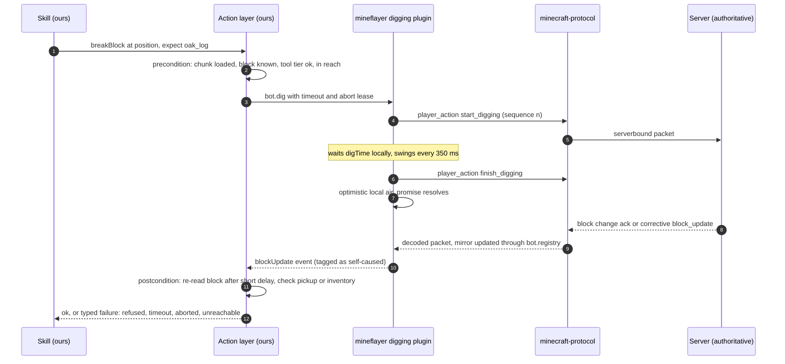
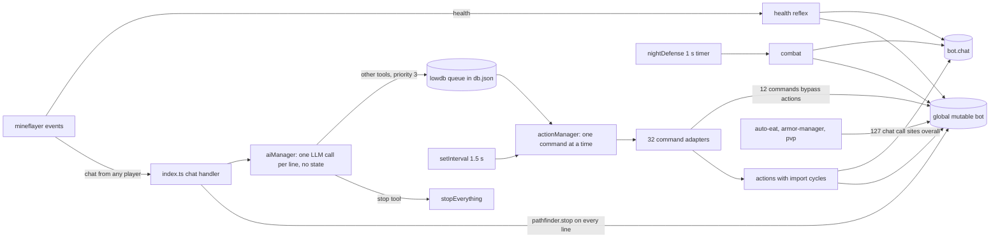
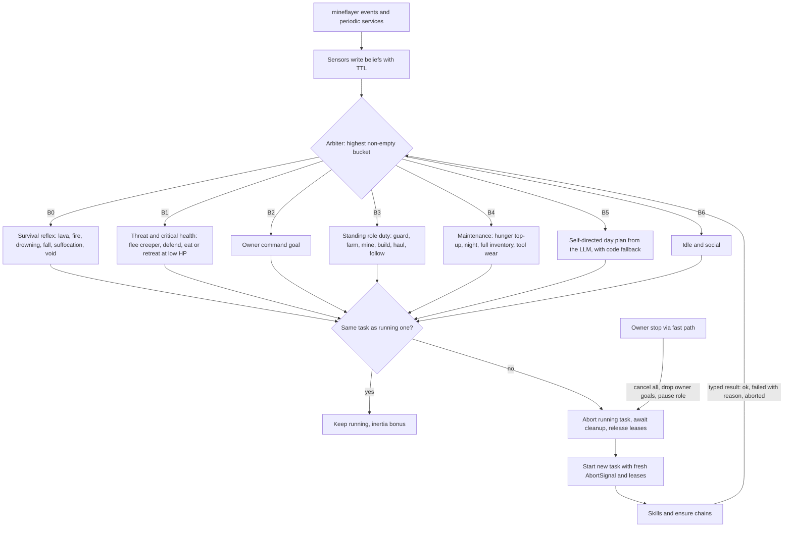
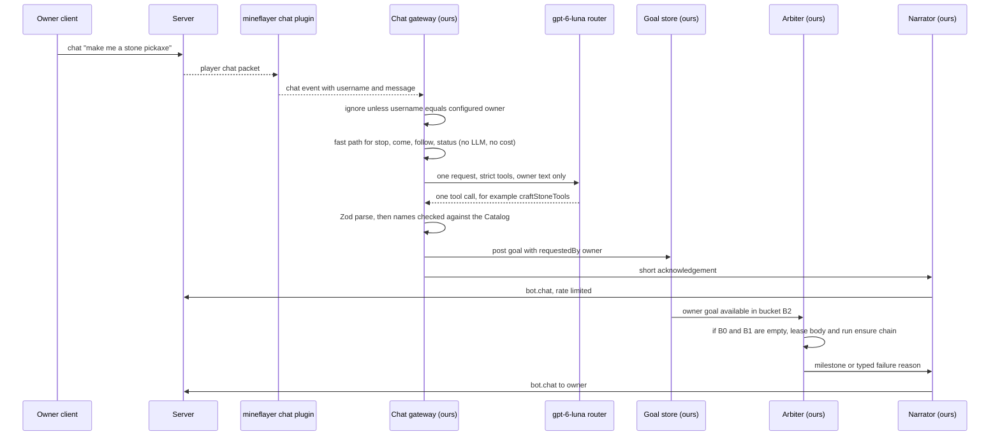
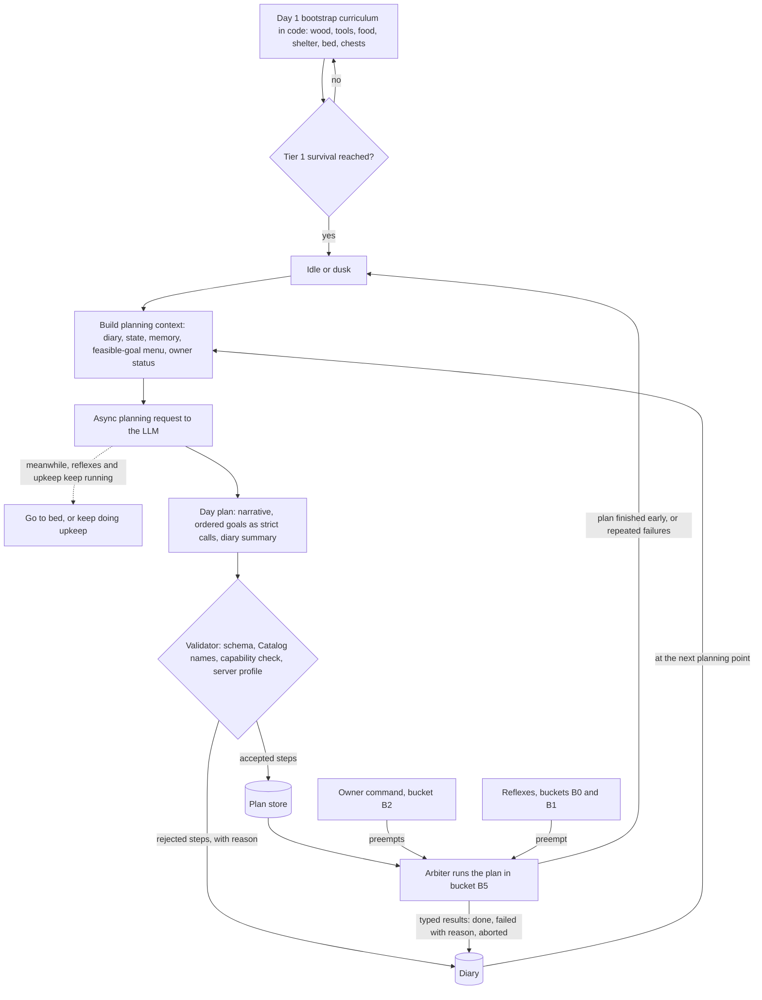
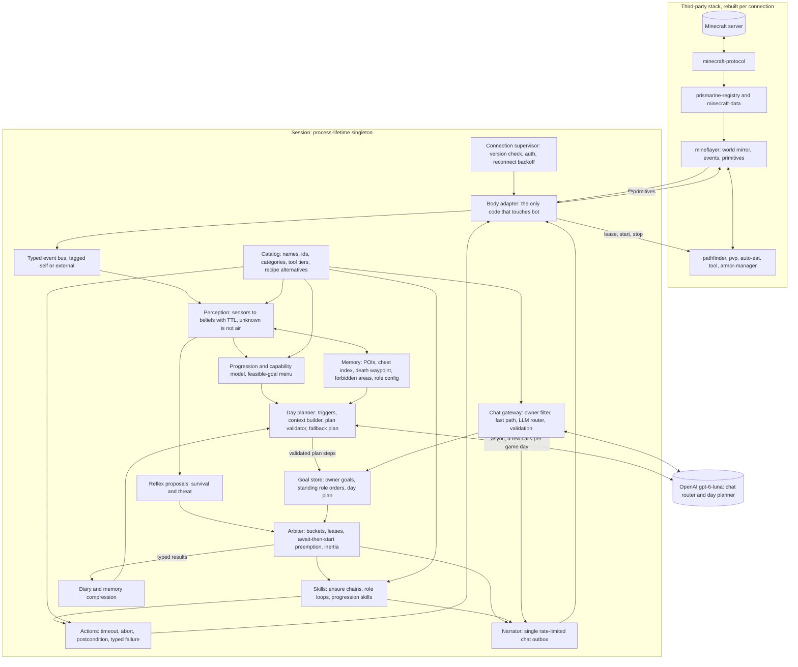

# Plan Slowly, Act in Code

> **Revision 2 (2026-11-24).** After review, the owner set the LLM's role: it is the bot's **decision maker**, not just a chat router. The bot keeps a **diary**. When it is idle, or at dusk before sleeping, it sends the diary and its state to the model. The model replies with a **plan for the next in-game day**, written as a list of strict function calls that code then executes. This revision adds [The LLM is the deliberator: a diary in, a day plan out](#the-llm-is-the-deliberator-a-diary-in-a-day-plan-out) and updates the summary, the layer stack, the arbitration ladder, the target picture and the conclusion to match.

minecraft-gpt should be built as a classic three-layer agent wrapped around the PrismarineJS stack. A **reactive controller** (mineflayer physics, the plugins we lease, and reflexes we own) runs at tick speed. A **sequencer**, meaning one arbiter, runs deterministic `ensure` chains and skills under a fixed priority ladder. The **deliberator is the LLM**: a slow, asynchronous planner that reads the bot's diary and state a few times per in-game day, and answers with a validated plan of goals. Code checks that plan against the bot's real abilities and carries it out. The LLM also routes the owner's chat, turning one owner message into one goal. In both roles it decides *what* to do next and never *how*: it is never consulted inside a running task, a reflex or a tick loop. The organising fact is that **the server owns the truth**. Everything the bot "knows" is a partial, lagging mirror rebuilt by minecraft-protocol, prismarine-registry, the prismarine object libraries and mineflayer. Everything it "does" is a request the server can correct, refuse, or (for inventory clicks on 1.17.1+) silently ignore. So every action has to be checked against fresh state. Identifiers follow the same layering. Numeric item, block and state IDs never leave the protocol and registry layers. Namespaced names like `oak_planks` are the contract for skills, memory and the LLM. Display names are for chat output only. Categories such as "any log" or "pickaxe of tier stone or better" belong to a catalog we own; today they are emulated with 52 substring matches. The current code already has most of the right pieces: ensure chains, AbortSignal cancellation, strict tools, a registry tied to the server version, and an unwired tier model. What it lacks is an arbiter, a diary and a planner. Two uncoordinated control paths fight over one mutable `bot`, and the system has no owner model, routes "stop" through an API call, and does not validate names. On cost, a planner consulted a few times per in-game day fits the budget easily; a model in the control loop does not. **$10 buys roughly 25,000 routed chat messages, or thousands of day plans (about $2–3 per month even for a bot online around the clock, see below), but only about 25–31 minutes of the frontier LLM agents that have actually beaten the Ender Dragon.** The hardest external constraint is the version window. **mineflayer 4.39 supports Minecraft only up to 26.1**, while 26.2 and 26.3 have already shipped, so the owner's world must stay at 26.1 or older.

> **Evidence convention used below.** Claims cited to repository files or to library source and primary docs are *verified* (read in source). Claims tagged **[inferred, not run]** come from static code reading and need confirming in-game. Claims tagged **[unconfirmed]** rest on secondary sources, abstracts or background knowledge. Codebase links are relative to this `reports/` folder.

## Seven third-party layers sit beneath seven of our own

My first move as a lead is always to stop thinking about "the bot" and start counting boundaries, because every boundary is a place where data changes shape and where failures hide. This stack has fourteen layers, and the line between the two halves matters more than any other.

```
  DIRECTION OF TRUTH ▲ (corrections, acks)            DIRECTION OF INTENT ▼ (requests)
 ┌──────────────────────────────────────────────────────────────────────────────────────┐
 │ L13 Gateway        owner filter · fast-path parser · LLM router · Narrator (chat out)  │  ours
 │ L12 Goals          LLM day planner · diary · owner goals · role orders · progression  │  ours
 │ L11 Arbiter        priority buckets · resource leases · preemption · reflexes         │  ours
 │ L10 Skills         ensure-chains, role skills, progression skills (pre/post-conds)    │  ours
 │ L9  Actions        verified primitives: timeout + abort + postcondition + typed fail  │  ours
 │ L8  Perception     sensors → beliefs (value, time, source, TTL); unknown ≠ air        │  ours
 │ L7  Body/Session   only code that touches bot.*; reconnect; plugin adapters; Catalog  │  ours
 ├════════════════════════════ third-party boundary ════════════════════════════════════┤
 │ L6  Ext. plugins   pathfinder 2.4.5 · pvp 1.3.2 (patched) · auto-eat 4.0.0 · tool ·   │
 │                    armor-manager — act autonomously on physicsTick/health/collect     │
 │ L5  mineflayer     ~40 internal plugins → world mirror, events, promise primitives    │
 │ L4  prismarine-*   Item, Block, Entity, Chunk, Windows, Physics, Recipe, Chat, NBT    │
 │ L3  Registry       prismarine-registry → bot.registry (+ server chat_type/dim/biome)  │
 │ L2  Static data    minecraft-data 3.119 per-version JSON (items, blocks, recipes …)   │
 │ L1  Wire           minecraft-protocol 1.68: TCP, compression, encryption, keepalive   │
 │ L0  Server         authoritative simulation, validation, Paper limits, claims         │
 └──────────────────────────────────────────────────────────────────────────────────────┘
```

The bottom half is well understood and verified from the installed sources. **minecraft-protocol** handles framing, compression, encryption, auth and keepalive, and turns packets into JS objects that still carry numeric IDs ([protocol notes, local `node_modules/minecraft-protocol/src/client/`](https://github.com/PrismarineJS/node-minecraft-protocol/blob/master/src/client/keepalive.js)). **minecraft-data** is static per-version JSON. **prismarine-registry** wraps it as `bot.registry` and overlays only three server-sent registries: `chat_type`, `dimension_type` and `worldgen/biome` ([prismarine-registry](https://github.com/PrismarineJS/prismarine-registry)). The registry is built once per connection from the server's ping version, and mineflayer refuses versions outside its tested range ([mineflayer loader.js](https://github.com/PrismarineJS/mineflayer/blob/master/lib/loader.js)). mineflayer itself is "a plain Node `EventEmitter` decorated by about 40 internal plugin functions". Those plugins share one mutable object, with **no unload, dependency declaration, ordering contract or versioning** ([plugin_loader.js](https://github.com/PrismarineJS/mineflayer/blob/master/lib/plugin_loader.js)). The most important negative fact is that mineflayer is a protocol client plus a world mirror plus primitive actions, and nothing more. It provides **no goal model, scheduler, preemption, uniform cancellation, durable memory, skill composition, perception summarisation or session continuity**. mindcraft builds all of these on top, sometimes with blunt tools such as a global interrupt flag and killing the process ([mindcraft action_manager.js](https://github.com/mindcraft-bots/mindcraft/blob/main/src/agent/action_manager.js)).

The top half is the part we design, and each layer exists to answer one question mineflayer leaves open. **L7 Body/Session** answers "who may touch `bot`?" The answer is only this layer, because `createBot` builds a fresh object per connection and plugin state lives in closures. **L8 Perception** answers "what do we believe, and how old is it?" **L9 Actions** answers "did the server actually accept that?" **L10 Skills** answers "how do I reach a state from here?" These are the existing `ensure*` chains, made bounded and cancellable. **L11 Arbiter** answers "what runs now, and what gets interrupted?" **L12 Goals** answers "what should I want next?", whether that is the owner's request, a standing role, or the next step of the LLM's day plan. The plan is checked against the progression model before anything runs. **L13 Gateway** answers "who is talking to me, what do they want, and how do I reply without spamming?" This split matches Gat's three-layer rule. Stateless, bounded-time behaviour goes in the controller. Memory of the past goes in the sequencer. Slow, future-predicting work goes in the deliberator, which is consulted asynchronously so that "several Behavior transitions" can happen while it thinks ([Gat 1998](https://u.cs.biu.ac.il/~galk/teach/current/intsys/readings/on-three-layer-arch-tla-1998.pdf)).

Communication changes character at every boundary, and the table below is the cheat sheet I would pin above the desk.

| Boundary | Carrier | Timing | Typical failure |
|---|---|---|---|
| Server ↔ minecraft-protocol | TCP packets; keepalive every 1–15 s | server ticks | `client timed out` after 30 s without keepalive ([keepalive.js](https://github.com/PrismarineJS/node-minecraft-protocol/blob/master/src/client/keepalive.js)) |
| protocol → registry/objects/world | parsed objects, IDs resolved via `bot.registry` | synchronous, inside the socket read path | a throwing listener "silently stops receiving packets" ([promise_utils.js](https://github.com/PrismarineJS/mineflayer/blob/master/lib/promise_utils.js)) |
| mineflayer → our code | `EventEmitter` callbacks plus reads of mutable state (`bot.entities`, `bot.inventory`) | synchronous, inline | slow handlers stall the world mirror and physics |
| our code → mineflayer | promise primitives, control states, pathfinder goals | async | false success, hang, or silent ignore (next section) |
| plugins ↔ mineflayer | same `bot`, `physicsTick` at 20 Hz, `health`, `playerCollect` | autonomous | plugins fight over the held item and movement ([mineflayer notes, §7](https://github.com/PrismarineJS/mineflayer/blob/master/lib/plugins/physics.js)) |
| our layers (to-be) | typed bus events, belief snapshot, goal objects, AbortSignal, typed results | async, single thread | arbitration bugs if more than one writer exists |
| Gateway ↔ OpenAI | HTTPS Chat Completions with strict tool schemas | hundreds of ms to seconds **[unconfirmed]** | API error, wrong tool, invalid name |
| Narrator → players | `bot.chat` → chat packet | rate-limited by us | spam kick (threshold **[unconfirmed]**) |

## The server owns the truth; every bot action is only a request

"Many actions happen at once" sounds like a concurrency problem, but in this stack it is really a *consistency* problem. Bun runs one JavaScript thread. Packet parsing, world-mirror updates, event emission, the 50 ms physics timer and all of our code take turns on it ([physics.js](https://github.com/PrismarineJS/mineflayer/blob/master/lib/plugins/physics.js)). Nothing literally runs in parallel. What happens "at once" is that the server keeps simulating other players, mobs, falling sand and our own pending requests while our code is busy. Every inbound event is therefore a late notice about something that has already happened, and every outbound call is a proposal the server will judge later.

**Inbound**, a server-side change is serialised into a clientbound packet and decoded by minecraft-protocol. Its numeric IDs are resolved through `bot.registry` into prismarine objects and written into mineflayer's mirror: chunk columns in `bot.world`, entities in `bot.entities`, the tab-list-driven `bot.players`, and inventory and windows. The event is then emitted *synchronously* ([entities.js](https://github.com/PrismarineJS/mineflayer/blob/master/lib/plugins/entities.js), [blocks.js](https://github.com/PrismarineJS/mineflayer/blob/master/lib/plugins/blocks.js)). The mirror is partial by construction. It holds only chunks within view distance, entities within tracking range, and container contents only while a window is open. Paper throttles chunk sending to 75/s per player and can falsify ores with anti-xray ([Paper global config](https://docs.papermc.io/paper/reference/global-configuration/)). Two consequences follow for perception. First, `bot.blockAt` returning null means **unknown, not air**. Second, `bot.players[name].entity == null` means "online but not tracked", not "offline". Both must be modelled explicitly ([mineflayer notes, §3](https://github.com/PrismarineJS/mineflayer/blob/master/docs/api.md)).

**Outbound**, the primitives are thin promise wrappers over packets. They differ in *when* they resolve, and this is where most "the bot says it did it but didn't" bugs come from. The table below lists the semantics I would design the action layer around. All of it is verified in the installed source.

| Primitive | Resolves when | Failure the action layer must normalise |
|---|---|---|
| `bot.dig` | the local dig timer elapses; mineflayer then **sets the block to air locally before any server confirmation** ([digging.js](https://github.com/PrismarineJS/mineflayer/blob/master/lib/plugins/digging.js)) | false success; a server rejection appears later as a corrective `blockUpdate` |
| `bot.placeBlock` (4.39) | a `blockUpdate` at the destination, waiting up to 5 s; it now throws "Server refused…" or "did not answer" ([place_block.js](https://github.com/PrismarineJS/mineflayer/blob/master/lib/plugins/place_block.js)) | replies carry no request id, so concurrent placements at the same spot share one outcome |
| window clicks (1.17.1+) | the server answers only when its record of the client is stale, so "a click they ignored is never reported" ([inventory.js](https://github.com/PrismarineJS/mineflayer/blob/master/lib/plugins/inventory.js)) | silent ignore; verifying needs a forced resync |
| `bot.craft` with a table | it waits for `windowOpen` with **no timeout of its own** ([craft.js](https://github.com/PrismarineJS/mineflayer/blob/master/lib/plugins/craft.js)) | can hang |
| pathfinder `goto` (2.4.5) | the goal is reached, or **it resolves on an empty path** (fixed on unreleased master) ([goto.js](https://github.com/PrismarineJS/mineflayer-pathfinder/blob/master/lib/goto.js)) | false success; may never settle |
| look/rotation | spread over several ticks by per-tick yaw limits ([physics.js](https://github.com/PrismarineJS/mineflayer/blob/master/lib/plugins/physics.js)) | an action fired before the look settles |

On the far side, the server validates. It rubber-bands movement that exceeds its thresholds ([MC-258862](https://bugs.mojang.com/browse/MC-258862)). It reconciles digging and placement by sequence number, and corrects inventory through container resyncs ([protocol Packets](https://minecraft.wiki/w/Java_Edition_protocol/Packets)). Paper adds kick-level limits: 500 packets per 7 s, and `recipe-spam-limit` 20 ([Paper global config](https://docs.papermc.io/paper/reference/global-configuration/)). The architectural rule I take from this is to **treat every outbound call as a request whose success is only known from a later authoritative update**. The action layer therefore wraps each primitive in four steps: a precondition check, a timed and abortable call, a postcondition re-read from fresh state, and a typed failure reason. This is Gat's "fail cognizantly" applied to a network game ([Gat 1998](https://u.cs.biu.ac.il/~galk/teach/current/intsys/readings/on-three-layer-arch-tla-1998.pdf)).

The full round trip for a single block break, from intent down to validation and back to a decision, looks like this.



A hostile hit takes the opposite route and shows why reflexes cannot wait for anything slow. A damage or health packet updates the health plugin, which emits `health` and `entityHurt`. A sensor turns that into a `threat` belief. The arbiter sees that a higher bucket is now non-empty and aborts the running skill through its AbortSignal. It waits for cleanup (pathfinder stopped, control states cleared, window closed) and then starts a defend or flee skill. That skill leases movement and hands, and drives `pvp`/`attack` or the pathfinder. The server then validates reach and cooldown and replies with entity and health updates. Every step is local code. LLM round-trips are inferred to take hundreds of milliseconds to seconds, while a creeper's fuse or a lava step resolves in roughly one to two seconds **[unconfirmed: no source gives a numeric budget]**. Every surveyed real-time system keeps reflexes out of the LLM path for the same reason ([Project Sid](https://arxiv.org/html/2411.00114v1), [mindcraft modes.js](https://raw.githubusercontent.com/mindcraft-bots/mindcraft/develop/src/agent/modes.js)).

Single-threadedness adds two hard rules. Listeners on high-volume events (`entityMoved`, `blockUpdate`, `physicsTick`) must stay O(1) and must never throw, because they run in the socket read path. CPU-bound work such as large `findBlocks` radii, big A* searches or recipe search must be bounded or time-sliced. Blocking the loop leaves the mirror stale, then makes physics catch up in bursts of up to 4 ticks, and past 30 s it drops the connection. The first and last effects follow directly from source; the catch-up burst is **[inferred, not run]** ([physics.js](https://github.com/PrismarineJS/mineflayer/blob/master/lib/plugins/physics.js), [keepalive.js](https://github.com/PrismarineJS/node-minecraft-protocol/blob/master/src/client/keepalive.js)). One subtle rule is borrowed from HTN practice: **tag events as self-caused or external**. Otherwise the bot's own dig produces a `blockUpdate` that triggers a replan and interrupts itself, which is exactly the pitfall Humphreys describes ([Humphreys, Game AI Pro ch. 12](http://www.gameaipro.com/GameAIPro/GameAIPro_Chapter12_Exploring_HTN_Planners_through_Example.pdf)).

## Today two uncoordinated paths drive one mutable bot

The as-is baseline (HEAD `78e3409` plus the uncommitted `ensure`/`CraftStoneTools`/`CraftWoodenTools` changes, about 8,600 lines in 63 files) has a **deliberative path** and a set of **reflex paths**, and nothing arbitrates between them. On the deliberative path, every chat line from *any* player becomes one `gpt-6-luna` call with `reasoning_effort: "none"`, 32 strict tools and no history or state. Only `tool_calls[0]` is used. The result is persisted to a lowdb queue at priority 3 and drained by a 1.5 s `setInterval`, one command at a time, with a 5-minute timeout and stuck detection ([aiManager.ts](../src/managers/aiManager.ts), [actionManager.ts](../src/managers/actionManager.ts), [index.ts](../src/index.ts)). The reflex paths run separately: the health handler, a 1 s `nightDefense` timer, auto-eat, armor-manager and pvp. They act directly on the exported mutable `bot` and compete with the queued command for the pathfinder, pvp and the held item ([health.ts](../src/actions/health.ts), [combat.ts](../src/actions/combat.ts)).



Reading this as a lead, I see sound instincts executed without a spine. The good parts are worth keeping. These are the `ensure` chains as idempotent "make it true" skills, `AsyncLocalStorage<AbortSignal>` cooperative cancellation, strict `zodFunction` tools, the per-server `bot.registry` lookups added in commit `639fd28` ([minecraftData.ts](../src/utils/minecraftData.ts)), reconnect with exponential backoff, and a progression model with six tiers ([botProgress.ts](../src/managers/botProgress.ts)). The defects are structural rather than cosmetic, and the table separates what was read from what still needs an in-game check.

| As-is finding | Status | Where |
|---|---|---|
| Any player's chat reaches the LLM and every command; no owner, allow-list or `requestedBy` | verified | [index.ts](../src/index.ts), [persistenceManager.ts](../src/managers/persistenceManager.ts) |
| `pathfinder.stop()` runs on *every* chat line from anyone | verified | [index.ts](../src/index.ts) |
| "stop" is recognised only *after* the OpenAI round-trip, so an API outage means no stop | verified | [aiManager.ts](../src/managers/aiManager.ts) |
| Reflexes run outside the AbortSignal context, so "stop" cannot cancel them and nightDefense re-engages | verified code; behaviour **[inferred, not run]** | [combat.ts](../src/actions/combat.ts) |
| Abort is `Promise.race`, not preemption; loops without cancellation checks (`ensureLocation`, `collectBlock`, `smeltItem`) keep driving the bot | **[inferred, not run]** | [ensureLocation.ts](../src/actions/ensureLocation.ts), [collectBlock.ts](../src/actions/collectBlock.ts) |
| `Unstack` contains a synchronous busy loop that would block the event loop | **[inferred, not run]** | [Unstack.ts](../src/commands/Unstack.ts) |
| The retry path likely re-runs a failing command indefinitely, because the duplicate check skips the re-queue | **[inferred, not run]** | [actionManager.ts](../src/managers/actionManager.ts) |
| Unknown names map to ID 0 (air), and callers test for `null`, not 0 | verified code; "collects air" effect **[inferred, not run]** | [minecraftData.ts](../src/utils/minecraftData.ts), [world.ts](../src/actions/world.ts) |
| 52 substring name matches (`"axe"` matches pickaxes, `"stick"` matches `sticky_piston`) | verified by grep | [inventory.ts](../src/actions/inventory.ts), [ensureTools.ts](../src/actions/ensureTools.ts) |
| The queue persists across restarts; `db.json` holds a pending `craftStoneTools` | verified | [db.json](../db.json) |
| `BotProgress`, `botLevels`, `loreManager` and `botConfig.json` have no importer | verified by grep | [botProgress.ts](../src/managers/botProgress.ts), [botLevels.ts](../src/progress/botLevels.ts) |
| `breath` event triggers `respawn()` | verified code; intent **[inferred]** | [index.ts](../src/index.ts) |
| 127 `bot.chat` sites across all layers; ~428 console calls | verified by grep | — |
| 7 runtime import cycles; 24 of 32 commands import the global `bot` | verified (hand-derived import graph) | [registry.ts](../src/commands/registry.ts) |
| `tsc` passes with the uncommitted changes | **[unconfirmed]** (not run) | — |

## One arbiter, ordered buckets, and no LLM inside the loop

The central design decision is to put **one arbiter that owns "what is running now"** at the centre. Only the arbiter starts and cancels skills. Reflexes, owner commands, role duties and autonomous progression are all *proposals* to it, never direct callers of `bot`. Shipped game AI converges on this shape. F.E.A.R. lets goals compete and has squad orders become goals that "fleeing from danger may trump" ([Orkin, GDC 2006](https://pages.cs.wisc.edu/~dyer/cs540/handouts/gdc2006_orkin_jeff_fear.pdf)). Behaviour trees use active selectors and observer aborts ([BT Starter Kit](http://www.gameaipro.com/GameAIPro/GameAIPro_Chapter06_The_Behavior_Tree_Starter_Kit.pdf), [Unreal BT](https://dev.epicgames.com/documentation/en-us/unreal-engine/behavior-tree-in-unreal-engine---overview)). The Sims-style dual utility puts a starving agent "only" in its Hunger bucket ([Graham, Game AI Pro ch. 9](http://www.gameaipro.com/GameAIPro/GameAIPro_Chapter09_An_Introduction_to_Utility_Theory.pdf)). mindcraft's ten modes are checked in priority order, each with an explicit `interrupts` scope, on a 300 ms tick with a ~100 ms budget per update ([modes.js](https://raw.githubusercontent.com/mindcraft-bots/mindcraft/develop/src/agent/modes.js)).



The ordering is the tech-lead judgement call, and I would defend it this way. **B0 and B1 outrank the owner** because a dead bot drops its inventory and serves nobody. This mirrors mindcraft's `self_preservation > unstuck > cowardice > self_defense` and the "fleeing may trump an order" rule ([modes.js](https://raw.githubusercontent.com/mindcraft-bots/mindcraft/main/src/agent/modes.js), [Orkin](https://pages.cs.wisc.edu/~dyer/cs540/handouts/gdc2006_orkin_jeff_fear.pdf)). **The owner's explicit command outranks standing role orders**: "come here" interrupts "farm wheat", and the role resumes afterwards. **Maintenance sits below roles** except when it becomes critical, and then it is promoted into B1. A guard does not wander off to top up hunger at 17/20 while the owner is under attack. **The day plan is the default background work** when nothing else is asked. It holds the LLM's chosen goals in order, and falls back to the next progression milestone when no plan is available. Within a bucket, a small utility score with an inertia bonus prevents flip-flopping between "mine iron" and "gather wood" ([Graham](http://www.gameaipro.com/GameAIPro/GameAIPro_Chapter09_An_Introduction_to_Utility_Theory.pdf)). The "unstuck" watchdog is a sequencer service rather than a bucket. It watches progress per task, escalates through a nudge, a replan and finally abandoning the goal, and records a failure fact with a TTL ("tree at X unreachable") so the planner does not retry blindly ([Orkin](https://pages.cs.wisc.edu/~dyer/cs540/handouts/gdc2006_orkin_jeff_fear.pdf)).

Three mechanisms make preemption real rather than cosmetic. The first is **resource leases**. Movement (pathfinder goals and control states), hands (held item, equip, consume), the open window, and the chat outbox each have exactly one holder at a time. Plugins that act on their own are either leased or replaced: auto-eat fires on `health` and `playerCollect`, armor-manager on `playerCollect`, and pvp and pathfinder on `physicsTick` ([mineflayer notes, §7](https://github.com/PrismarineJS/mineflayer/blob/master/lib/plugins/physics.js)). Today `useTacticsForTarget` even replaces the tuned `Movements` with a fresh default instance ([combat.ts](../src/actions/combat.ts)). The second is **await-then-start cancellation**. The arbiter aborts the running task, *awaits* its cleanup (stop the pathfinder, clear control states, stop digging, close the window), and only then starts the next one. BehaviorTree.CPP's race, where a new child starts before the old one halts, is the cautionary example ([BT.CPP #1031](https://github.com/BehaviorTree/BehaviorTree.CPP/issues/1031)). The existing AbortSignal is the right primitive; what is missing is an arbiter that enforces it and skills that honour it. The third is **resume by replanning**. An interrupted *goal* goes back on the stack; its *plan* is discarded and rebuilt from current beliefs when the goal resumes. This is the HTN/GOAP practice, and it is what makes `ensure`-style skills (check, then act only if needed) the right unit ([Humphreys](http://www.gameaipro.com/GameAIPro/GameAIPro_Chapter12_Exploring_HTN_Planners_through_Example.pdf)).

The owner's chat route then becomes short and cheap, and it honours every stated constraint. The LLM is a router producing exactly one strict tool call. Commands are fire-and-forget from the LLM's point of view. Progress is observed in bot state and reported with `bot.chat`. Only the configured owner is obeyed.



A few decisions inside that picture are worth stating out loud. **"stop" must never depend on the network.** mindcraft lets a human's `!command` bypass the LLM entirely at zero cost ([agent.js](https://raw.githubusercontent.com/mindcraft-bots/mindcraft/develop/src/agent/agent.js)). The same deterministic fast path should handle stop, come, follow and a status query. "What are you doing?" is answered by code from the arbiter's state and the current day plan, so it is instant and free. **Fire-and-forget at the LLM boundary does not mean the goal has no lifecycle internally.** The goal store tracks pending, running, suspended, done and failed-with-reason, and the Narrator reports transitions. **Owner goals should be volatile, standing orders durable.** Persisting a queued command means it resumes after a restart without fresh intent, which is what `db.json` shows today ([db.json](../db.json)). Role configuration, points of interest, the chest index, the death waypoint and forbidden areas are the knowledge worth persisting. Finally, the **Narrator** replaces 127 scattered `bot.chat` calls with one rate-limited, de-duplicated outbox. It can whisper to the owner and is the only place display names are rendered. Exact server spam-kick thresholds remain **[unconfirmed]**.

The owner-only rule has one security caveat. On an offline-mode server, usernames are not authenticated ([protocol FAQ](https://minecraft.wiki/w/Java_Edition_protocol/FAQ)), so "obey the configured owner name" is only as strong as the server's login. In the owner's own game that is acceptable. It is worth writing down so nobody later mistakes it for authentication. mindcraft's `only_chat_with` allow-list is the same model ([settings.js](https://raw.githubusercontent.com/mindcraft-bots/mindcraft/develop/settings.js)).

On the singleton: one in-game character justifies one process-wide agent object, and I agree with keeping it. The lifetime that matters, though, is **Session versus Body**. The Session (goals, memory, catalog configuration, the Narrator) lives for the whole process. The Body (the mineflayer instance, its plugins and its listeners) is rebuilt on every reconnect, because mineflayer has no built-in reconnect and keeps plugin state in closures ([loader.js](https://github.com/PrismarineJS/mineflayer/blob/master/lib/loader.js), [mineflayer#3372](https://github.com/PrismarineJS/mineflayer/issues/3372)). Today's `export let bot` live binding is an informal version of this split. It leaks module-scoped state across instances: `previousHealth` in `health.ts` survives reconnects ([health.ts](../src/actions/health.ts)).

## The LLM is the deliberator: a diary in, a day plan out

The owner's model for the LLM is the bot's reasoning, not just its ears. While the bot works, it keeps a **diary**. When it runs out of things to do, or at dusk before going to bed, it sends the diary, its current state and its long-term memory to the model. The model replies "in character" with a **plan for the next in-game day**: a short list of goals written as strict function calls, which code validates and executes. By the time the bot wakes up, the plan is waiting. This is the textbook shape of a deliberator. In Gat's 3T/RAPs variant the deliberator "produces whole plans for the sequencer to execute", and it is consulted asynchronously, so several behaviour transitions can happen before it answers ([Gat 1998](https://u.cs.biu.ac.il/~galk/teach/current/intsys/readings/on-three-layer-arch-tla-1998.pdf)). The real-time argument from the rest of this report still holds, because the model never sits between a sensor and a reaction. Its answer is consumed hours of game time later, as goals. Project Sid uses the same split: fast non-LLM reflexes and a slow LLM "cognitive controller" ([Project Sid](https://arxiv.org/html/2411.00114v1)).

The division of labour is the key design choice. **Code knows what is possible; the model decides what is worth doing.** Code computes a menu of feasible next steps from the progression graph and the capability model, for example "iron tools are reachable: you have a stone pickaxe, iron ore was seen at (x, y, z)". The model chooses, orders and explains, and adds the personality: why today is a mining day, what to tell the owner. Code then executes each goal with the existing `ensure` chains and skills, which handle caves, water and unbreakable blocks with if/else logic. This keeps the model's known weaknesses, such as made-up recipes, wrong item names and slow reactions ([LLM agents notes](https://arxiv.org/html/2305.16291v2)), away from anything time-critical. It also uses its strengths: prioritising, long-horizon judgement, story and conversation.

### The bot's day



Day 1 needs no model. Surviving the first night is the same every time: logs, a crafting table, wooden then stone tools, food, a shelter, a bed and a couple of chests. Code does that best and costs nothing. The owner's "first grade of survival" is therefore the point where planning starts, which matches the Tier 1 "Basic Survival" milestone the progression layer already sketches ([botProgress.ts](../src/managers/botProgress.ts)).

### When the bot asks for a plan

| Trigger | Why | Guard |
|---|---|---|
| **Dusk or bedtime** (main cycle) | plan tomorrow while the night is spent sleeping or sheltering | once per in-game day |
| **Idle**: no owner goals, no plan steps left | the bot has nothing worthwhile to do | rate-limited, for example once per half-day |
| **Plan blocked**: two or more steps failed | yesterday's plan no longer fits the world | rate-limited; the failure reasons go in the request |
| **Big event**: death, the owner joins, a role assigned or removed | the situation changed a lot | at most one extra call per event |
| **Owner asks** ("what's your plan?", "let's build a farm today") | the owner shapes the plan | routed through the gateway; one call |

Planning never depends on actually sleeping. On a multiplayer server, the night only skips when enough players sleep (`playersSleepingPercentage`), so the dusk trigger fires on game time, not on waking up. The bot needs a bed for the "sleep and wake with a plan" story, which is one more reason the bed belongs in the Day 1 curriculum. **[game rule from background knowledge, unconfirmed this session]**

### What goes in, what comes out

The **diary is written by code, not by the model**. That keeps it cheap and factual. Each typed result from the arbiter (milestone reached, item gains, death and its cause, discoveries such as a village, a cave, lava or ore, failures with reasons, owner interactions) becomes one short, human-sounding line from a template: "Morning: chopped 12 oak logs near the river. Noon: a creeper blew up part of the wall; repaired it. Couldn't reach the iron at (120, 12, -40): lava in the way." Long-term memory grows by compression. Each plan response includes a summary of the day just finished. That summary replaces the raw diary, and only the last few summaries (plus an occasional "life story" roll-up) travel with each request. This keeps each request roughly the same size however long the bot has lived.

| Planning request contains | Size (rough) |
|---|---|
| Persona and role, server profile, budget rules | small |
| Owner status: online or offline, standing orders, last request | small |
| State snapshot: health, food, tier and capabilities, inventory by category, chest index summary, base and points of interest, time, weather, dimension | ~1k tokens |
| Today's diary | ~1–2k tokens |
| Memory: recent day summaries | ~1k tokens |
| **Feasible-goal menu computed by code** plus the strict goal vocabulary | ~3.7k tokens (today's tools) |

| Day plan contains (one strict schema) | Used by |
|---|---|
| `narrative`: one or two in-character sentences | Narrator, shown to the owner if online |
| `steps`: 3–8 goals, each a strict call from the goal vocabulary with a short `why` | Validator, then the plan store |
| `daySummary`: compressed memory of the day just finished | Memory |
| optional `ownerMessage`: a question or suggestion for the owner | Narrator |

Plan steps are **goals, never primitives**. Examples are "reach milestone `iron_tools`", "stock 20 cooked food", "build a shelter at base", "explore north for a village", "farm the wheat field", "guard the owner". Each maps to a skill or `ensure` chain. A step like "dig block at x,y,z" would put the model back in the control loop and is not in the vocabulary. The goal vocabulary is the same strict-tool set the owner's chat router uses, so one schema, one Zod parse and one Catalog check serve both paths.

### Validation and execution

Every plan is **untrusted input**. The validator runs four checks:
1. **Schema**: Zod parse, as today.
2. **Names**: every item, block or mob name is checked against the Catalog.
3. **Feasibility**: the step is checked against the capability model. A step whose prerequisites are missing is either expanded by the `ensure` chains (diamonds need an iron pickaxe, so get one first) or rejected with a reason.
4. **Policy**: the server profile and forbidden areas, such as claims, no PvP, or no automation.

Rejected steps and their reasons go into the diary, so the next plan learns from them. Accepted steps go to the plan store and run in bucket B5. Each step is **re-validated when it starts**, because a plan made at dusk can be stale by noon: the bot died, a creeper took the chest, the owner moved the base. Owner commands (B2) and reflexes (B0, B1) preempt plan steps as usual. An interrupted step resumes by code replanning from current beliefs, not by asking the model again.

**The bot must survive without the model.** If the API is down, the budget is spent or the answer fails validation, a deterministic fallback plan takes over: the next progression milestone plus upkeep. Planning is an upgrade to the bot's judgement, not a dependency for staying alive.

### How the owner fits in

The owner always outranks the plan. If the owner is online and gives a command, it runs in B2 and the plan pauses. If the owner is online but quiet, the bot can share its plan ("Today I want to mine iron; want to come?") through the `ownerMessage` field. If the owner is offline, the bot lives by its plan. A standing role narrows the plan: a bot assigned as the owner's farmer gets "role: farmer, field at X, storage chest Y" in its context, and plans inside it. The owner can also edit the plan in chat ("skip mining today, build a fence around the farm"), which the router turns into a plan change.

### Cost

At gpt-6-luna's researched list price ($0.10 per 1M input tokens, $0.50 per 1M output), one planning call of about 7k input and 0.8k output tokens costs about **$0.0011**. An in-game day lasts 20 real minutes.

| Bot online | Day plans per real day | Monthly cost (×2 for replans) |
|---|---|---|
| 4 h per day | ~12 | ~$0.40 (~$0.80) |
| 24 h per day | ~72 | ~$2.40 (~$4.80) |

Owner chat routing comes on top, at about $0.0004 per message. Both fit inside the $10 target with room to spare. Prompt caching of the static prefix (tools and persona) would lower this further, but the cached-price behaviour of this model has not been verified.

### Open questions for this design

- **Reasoning and tools on the same call: verified 2026-11-24 with live calls** (openai SDK 7.62, a 5-goal plan schema built with Zod). The planner should use the **Responses API with strict function tools and `reasoning.effort`**. It keeps the same `zodFunction` goal vocabulary as the chat router and lets the model think before answering.

  | Combination | `low` | `medium` | Latency |
  |---|---|---|---|
  | Chat Completions + strict tools + reasoning | ❌ 400: "Function tools with reasoning_effort are not supported for gpt-6-luna in /v1/chat/completions. To use function tools, use /v1/responses or set reasoning_effort to 'none'." | ❌ same | — |
  | Chat Completions + `json_schema` output + reasoning | ✅ 120 reasoning tokens | ✅ 205 | ~4.5 s |
  | **Responses + strict function tools + reasoning** | ✅ 0 reasoning tokens | ✅ 178 | ~4–4.5 s |
  | Responses + `json_schema` output + reasoning | ✅ 92 | ✅ 193 | ~4–5 s |
  | Chat Completions + strict tools + `none` (today's router) | ✅ | — | ~2.6 s |

  Reasoning adds roughly 100–200 output tokens per plan, about $0.0001 at list price. That is negligible next to the ~$0.0011 base cost, and a 4–5 s answer is irrelevant for a plan used the next in-game morning. Two details matter for the validator. First, with `low` effort the model returned only 2 goals when the prompt asked for 3–5. The goal count must therefore be enforced in code, not trusted from the prompt. Second, the owner's chat router can stay on Chat Completions with `none` (fastest), or move to the Responses API with `low` effort if routing mistakes show up in practice.
- **How big a plan should be.** One in-game day (3–8 goals) is a good default. Longer plans go stale; shorter plans cost more calls.
- **The goal vocabulary.** It needs a few higher-level goals beyond today's 32 commands (`reachMilestone`, `stockFood`, `explore`, `buildShelter`, `farmArea`) so the model plans at the right level.
- **Diary templates.** What counts as an event worth a line, and how lines are worded, shapes the model's judgement more than the system prompt does. This needs iteration in real games.

## Names are the contract; numbers never leave the registry

Identifiers are where a Minecraft bot quietly rots, because the same oak plank has at least four identities, and each is owned by a different layer. In minecraft-data the oak planks item is **ID 5 (`planks` plus metadata) in 1.12, 13 in 1.13.2, and 36 in 1.21.4 through 26.1**. The block is ID 13 with state ID 15, `oak_log` in 26.1 is block 49 with **state IDs 136–138 for `axis`**, and the 26.1 planks recipe is stored as `{"ingredients":[134],"result":{"id":36,"count":4}}`, keyed entirely by numbers ([protocol notes: minecraft-data pc/{1.12…26.1}](https://github.com/PrismarineJS/minecraft-data)). On the wire, synchronised registries get their numeric IDs from the *order* of Registry Data packets during Configuration, so numbers are a per-session encoding, not a name ([protocol FAQ](https://minecraft.wiki/w/Java_Edition_protocol/FAQ)). Since 1.20.5, item data is a set of components (`damage`, `max_damage`, `custom_name`, `enchantments`, `food`, `tool`…) layered on per-type defaults ([Data component format](https://minecraft.wiki/w/Data_component_format)). Since 1.21.2, the server sends only *unlocked* recipes, as recipe-book "displays" ([protocol Recipes](https://minecraft.wiki/w/Java_Edition_protocol/Recipes)). mineflayer ignores those displays and crafts from static minecraft-data recipes through `prismarine-recipe` ([craft.js](https://github.com/PrismarineJS/mineflayer/blob/master/lib/plugins/craft.js)). Tags churn as well: 26.1 split `#dirt` into `#mud`, `#moss_blocks` and `#grass_blocks` ([Java Edition 26.1](https://minecraft.wiki/w/Java_Edition_26.1)).

```
   SERVER (defines)                 THIRD-PARTY CLIENT (translates)                 OURS (interprets)
 ┌──────────────────────┐   ┌───────────────────────────────────────────┐   ┌────────────────────────────────────┐
 │ registries (ns names)│   │ L1 wire: numeric item id 36, state id 15, │   │ L7 Catalog — the ONLY place that   │
 │ order → numeric ids  │──▶│    hashed components (serverbound)        │   │    maps name ⇄ id, defines         │
 │ tags (Update Tags)   │   │ L2 minecraft-data: per-version JSON,      │──▶│    categories (any_log, planks_of, │
 │ components per stack │   │    static recipes keyed by numeric ids    │   │    pickaxe≥stone, hostile), tool   │
 │ unlocked recipe      │   │ L3 bot.registry: itemsByName, blocksBy-   │   │    tiers, recipe alternatives      │
 │   displays (1.21.2+) │   │    StateId; + chat_type/dimension/biome   │   │ L8–L12 skills, beliefs, goals,     │
 │ custom_name, lore    │   │ L4 Item{type,name,displayName,components, │   │    memory, LLM schema: NAMES and   │
 └──────────────────────┘   │    customName} Block{name,stateId,props}  │   │    CATEGORIES only, never numbers  │
                            │ L5 findBlocks(ids) recipesFor(id) craft() │◀──│ L9 Actions: ask Catalog for ids at │
                            └───────────────────────────────────────────┘   │    call time (per connection)      │
                                                                            │ L13 Narrator: displayName/custom-  │
                                                                            │    Name for humans only            │
                                                                            └────────────────────────────────────┘
```

| Identifier form | Example | Defined by | May be used by | Stability |
|---|---|---|---|---|
| Numeric item / block ID | item 36, block 13 (26.1) | server registry order; minecraft-data per version | L1–L5 and the Catalog only | changes across versions (5 → 13 → 36) |
| Block-state ID | 15; `oak_log` 136–138 | per version | L1–L5, Catalog | least stable |
| Namespaced ID | `minecraft:oak_planks` / `oak_planks` | Mojang | everyone: skills, memory, persistence, LLM | mostly stable; renames happen (`planks`→`oak_planks`, boat split in 1.21.2) |
| Display name | "Oak Planks" | item enum / language | Narrator only | not unique historically ("Wood Planks"/"Wooden Planks"), localised |
| `custom_name` component | an anvil-named sword | players, plugins | Narrator; resolving owner references | per stack |
| Tags | `#dirt` → `#mud`, `#moss_blocks`, `#grass_blocks` (26.1) | server data | Catalog (mineflayer's handling of Update Tags **[unconfirmed]**) | changes between versions |
| Data components | `damage`, `food`, `tool`, `enchantments` | 1.20.5+ | Perception (durability, food value) | new components each version |
| Recipes | minecraft-data JSON vs server displays | static data vs server | Catalog and crafting skills; the server can overrule | data packs and plugins can diverge |
| Entity names and metadata | `zombie`, `oak_boat`; metadata index | per version | Perception | metadata indices are version-dependent |
| Our categories | `any_log`, `pickaxe≥stone`, `hostile` | us | skills, progression, a small LLM enum | ours to version |

The ownership rules follow directly. **Numbers are resolved at call time through the live `bot.registry` and are never persisted, logged as meaning, or shown to the LLM.** **Namespaced names are the cross-layer contract**, and every name that enters from the LLM, memory or configuration is validated against the registry *at the gateway*, not deep inside an action. **Semantic groupings are a Catalog concern.** Examples are "any log including nether stems", "the planks this log produces", "a pickaxe of tier stone or better" and "hostile". The Catalog derives these from registry data and explicit tables, never from `name.includes()`. **Display names exist only on the way out.** The current code breaks every one of these rules somewhere. `getItemId` returns 0 (air) for unknown names. `ensurePlanks` builds `stripped_oak_planks` from a stripped log. `WOOD_TYPES` lacks mangrove, cherry, bamboo and pale oak. The dead progression tiers use the non-IDs `planks` and `wooden_planks`. `isHuntable` reads `metadata[16]`, a version-dependent index ([minecraftData.ts](../src/utils/minecraftData.ts), [ensure.ts](../src/actions/ensure.ts), [botProgress.ts](../src/managers/botProgress.ts)).

One open question deserves a trade-off note: should the strict tool schema carry an enum of valid item names? Enumerating the roughly 1,000 items ([Project Sid](https://arxiv.org/html/2411.00114v1)) in every request would multiply the ~3,680-token prompt that today costs about $0.0004 per message. My position is to keep free-text names in the schema with a short category enum alongside. Names are normalised and validated against the Catalog after the call. On a miss, the bot asks a clarifying question rather than guessing. Because recipes come from static data that "the server can overrule", a craft is verified by a postcondition (the item appeared), not trusted from the recipe ([protocol notes, §4](https://minecraft.wiki/w/Java_Edition_protocol/Recipes)).

## Progression, roles and the dragon share one capability model

The two product goals look different but run on the same machinery. **Goal 1 (finish the game solo)** is a dependency graph with alternative producers. **Goal 2 (farmer, guard, miner, builder, hauler, companion)** is a set of standing orders that use the same skills inside a bounded area. A single **capability model** joins them: predicates such as "can mine iron", "can smelt", "has bucket" and "can reach the Nether". These are computed from live beliefs: inventory, plus a chest index with timestamps, plus known points of interest.

```mermaid
flowchart LR
    LOG["logs"] --> PL["planks"] --> CT["crafting_table"]
    PL --> ST["sticks"]
    CT --> WP["wooden_pickaxe"]
    ST --> WP
    WP --> CB["cobblestone"] --> SP["stone_pickaxe and furnace"]
    SP --> IR["raw_iron and coal"] --> II["iron_ingot"]
    II --> BK["bucket"]
    II --> IP["iron_pickaxe"]
    II --> FS["flint_and_steel"]
    II --> AR["shield and iron armor"]
    IP --> DM["diamonds, optional"] --> DP["diamond_pickaxe"]
    DP -->|"OR, mine obsidian"| OB["obsidian portal frame"]
    BK -->|"OR, water over lava"| OB
    OB --> NP["Nether portal lit"]
    FS --> NP
    NP --> FT["fortress: 6 or more blaze rods"]
    NP -->|"OR"| BA["bastion: barter gold for pearls"]
    NP -->|"OR"| EM["endermen: pearls"]
    FT --> BP["12 or more blaze powder"]
    BA --> EP["12 or more ender pearls"]
    EM --> EP
    BP --> EY["eyes of ender plus spares"]
    EP --> EY
    EY --> SH["stronghold by triangulation"] --> EPR["End portal"] --> DR["dragon: 10 crystals, 200 HP"]
```



The graph's edges come from the wiki. A blaze drops a rod only 50% of the time, and only to a player or tamed-wolf kill ([Blaze](https://minecraft.wiki/w/Blaze)). Endermen drop 0–1 pearl ([Enderman](https://minecraft.wiki/w/Enderman)). Bartering averages about 15.6 gold ingots per pearl ([Bartering](https://minecraft.wiki/w/Bartering)). An eye shatters 20% of the time per throw ([Eye of Ender](https://minecraft.wiki/w/Eye_of_Ender)). Ring-one strongholds sit 1,280–2,816 blocks from the origin ([Stronghold](https://minecraft.wiki/w/Stronghold)). The dragon has 200 HP and is healed by 10 crystals ([Defeating the Ender Dragon](https://minecraft.wiki/w/Tutorials/Defeating_the_Ender_Dragon)). Several recipe quantities in the early nodes are general game knowledge **[unconfirmed this session]**. The OR-nodes are the important design feature. Obsidian can come from a diamond pickaxe *or* from casting water over lava. Pearls can come from bartering *or* from endermen. That points to an HTN/GOAP-style planner with alternative methods and replanning, rather than one fixed script ([Humphreys](http://www.gameaipro.com/GameAIPro/GameAIPro_Chapter12_Exploring_HTN_Planners_through_Example.pdf), [Orkin](https://pages.cs.wisc.edu/~dyer/cs540/handouts/gdc2006_orkin_jeff_fear.pdf)). The existing `ensure` chains are this planner in embryo: `ensurePickaxe` → planks/sticks/cobblestone → `gatherWood`. The architecture formalises them as skills with declared preconditions and effects, which also removes today's `ensure ⇄ ensureTools ⇄ crafting ⇄ collectBlock` import cycles. The planner composes the skills; the skills no longer call each other ([ensure.ts](../src/actions/ensure.ts), [ensureTools.ts](../src/actions/ensureTools.ts)).

The unwired progression layer is the natural home for this. Its six tiers (Basic Survival, Stone Tools, Iron Working, Advanced Construction, Diamond Tools, Nether Exploration) are a good skeleton ([botProgress.ts](../src/managers/botProgress.ts)). As written, though, it would read the stale `ListInventory` snapshot, use invalid names, and chat every 30 s. In the to-be design, tiers become **milestones derived from the capability model**. They are re-evaluated on inventory or chest-index change instead of on a timer. They are extended past "Nether Exploration" with Blaze & Pearls, Eyes, Stronghold and End. They feed two consumers. The goal store uses them to pick the next autonomous milestone in B5. The gateway and arbiter use them to check an owner's request before accepting it, so the bot can say "I need an iron pickaxe for diamonds; getting one first" instead of failing deep in an action.

Roles reuse everything. Mods and Baritone converge on one shape: **Role = job + anchor (area or waypoint) + stance + targets + supplies + storage**. MineColonies binds a farmer to a field and a guard tower has a patrol radius ([MineColonies guard tower](https://minecolonies.com/wiki/buildings/guardtower/)). Human Companions toggles follow, patrol and guard, and avoids creepers ([Human Companions](https://www.curseforge.com/minecraft/mc-mods/human-companions)). Baritone's `farm`, `mine`, `build` and `follow` are the primitive processes ([Baritone USAGE](https://github.com/cabaletta/baritone/blob/master/USAGE.md)). For our bot, a role is a durable standing order in bucket B3. The LLM's only job is to fill its parameters ("guard me", "farm the wheat by the house and put it in the left chest"). The role's skill loop runs in code, and B0–B2 interrupt it as needed. Each role carries its own risk rules, enforced as hard constraints. A guard never targets players, pets, villagers or golems. A farmer replants and never jumps on farmland. Any role treats a refused break, place or open inside a claim as a durable "forbidden area" fact rather than retrying into the packet limiter ([GriefPrevention commands](https://github.com/GriefPrevention/GriefPrevention/wiki/Commands), [Paper global config](https://docs.papermc.io/paper/reference/global-configuration/)).

Goal 1 needs one honest caveat. The only documented autonomous dragon kills are by **frontier LLM coding agents**. A four-agent Gemini 4 Argon team took 27 h 14 m with 605 deaths on Easy, at about $520 at introductory list price ([arXiv 2610.22319](https://arxiv.org/html/2610.22319)). A single Claude Opus 5 agent on an MCP harness took 3 h 56 m for $93.17, self-reported ([HF dataset](https://huggingface.co/datasets/aibengineering/beat-the-game-minecraft)). Earlier academic agents generally stalled at diamond: Voyager unlocked it in 1 of 3 trials ([Voyager](https://arxiv.org/html/2305.16291v2)). The notes contain **no documented case of a deterministic, code-only mineflayer bot beating the dragon**. Under a $10/month budget, which is about 25–31 minutes of those runs, the code-first route is not just preferred but forced. The architecture should expect the last three nodes (Nether navigation, stronghold triangulation, the dragon fight) to need purpose-built skills of their own, not generic "go and mine" behaviour. Both successful runs relied on exact mineflayer perception, which our bot shares ([arXiv 2610.22319](https://arxiv.org/html/2610.22319)).

## Hard limits come from versions, auth, the event loop, server policy and budget

Every layer imposes a constraint that an architecture can absorb but not remove. The most consequential is also the easiest to miss. **mineflayer 4.39.0 tests 1.8.8 through 1.21.11 plus 26.1, and its `latestSupportedVersion` is 26.1** ([version.js](https://github.com/PrismarineJS/mineflayer/blob/master/lib/version.js)). Meanwhile 26.2 (protocol 776) and 26.3 (protocol 777) have shipped, and installed minecraft-data 3.119.0 has no data paths for either ([minecraft-data](https://github.com/PrismarineJS/minecraft-data)). Testing happens in the owner's real game, so that game must run 26.1 or older until mineflayer catches up. This is the first thing to check, before any architectural work pays off.

| Constraint | Consequence for the architecture | Status |
|---|---|---|
| mineflayer 4.39 supports up to 26.1; 26.2/26.3 unsupported ([version.js](https://github.com/PrismarineJS/mineflayer/blob/master/lib/version.js)) | pin the owner's world to ≤26.1; one place (Session) checks the version and fails loudly | verified |
| No `auth` passed to `createBot`, so the bot assumes an offline-mode server ([index.ts](../src/index.ts)) | a vanilla "Open to LAN" world likely needs a Microsoft-authenticated bot account or a mod such as OfflineLAN ([OfflineLAN](https://modrinth.com/mod/offlinelan)) | LAN online-mode behaviour **[unconfirmed]** |
| `white-list` defaults to true from 26.3 snapshot 2 ([Server.properties](https://minecraft.wiki/w/Server.properties)) | the bot must be whitelisted on newer servers | verified |
| One JS thread; listeners run in the packet path; 30 s keepalive window | O(1), non-throwing listeners; bounded or time-sliced CPU work; LLM calls never awaited inside a reflex | verified mechanism; burst behaviour **[inferred, not run]** |
| Partial mirror: view distance, entity tracking, 75 chunks/s on Paper, anti-xray ([Paper](https://docs.papermc.io/paper/reference/global-configuration/)) | beliefs carry "unknown"; ore sightings are hints; findBlocks radii bounded | verified |
| Server validation of movement, dig, place, inventory ([MC-258862](https://bugs.mojang.com/browse/MC-258862), [Packets](https://minecraft.wiki/w/Java_Edition_protocol/Packets)) | postcondition checks on every action; serialise actions per resource | verified |
| Paper packet limiter 500 per 7 s; `recipe-spam-limit` 20 (kick) ([Paper](https://docs.papermc.io/paper/reference/global-configuration/)) | throttle crafting clicks and retries | verified |
| pathfinder 2.4.5 on npm misses about 15 months of master fixes; pvp frozen and patched; auto-eat v5 is ESM-only with a different API ([pathfinder commits](https://github.com/PrismarineJS/mineflayer-pathfinder/commits/master), [auto-eat](https://github.com/link-discord/mineflayer-auto-eat)) | plugins live behind Body adapters so they can be swapped, vendored or replaced | verified |
| Bun is not in upstream CI (Node 24 is) ([history.md](https://github.com/PrismarineJS/mineflayer/blob/master/docs/history.md)) | keep the code runnable under Node as a hedge | Bun compatibility **[unconfirmed]** |
| Strict tool arguments; OpenRouter not used for that reason ([README](../README.md)) | the provider choice is coupled to the strict-schema design in every command | verified |
| ~$10/month; measured ~$0.0004 per message at ~3,680 input tokens | ≈25,000 routed messages/month; no LLM in loops; deterministic fast path for common commands | owner-measured |
| Chat spam limits and server automation rules vary ([Spigot config](https://docs.papermc.io/paper/reference/spigot-configuration)) | a single rate-limited Narrator; a server profile (automation allowed, PvP, claims) | thresholds **[unconfirmed]** |

## The to-be architecture in one picture

Putting the pieces together gives the target picture below. The third-party stack is unchanged and sealed behind the Body adapter. Above it, data flows up through perception, decisions flow down through one arbiter, and the LLM touches only two slow, asynchronous edges: the owner's chat gateway, and the day planner fed by the diary.



| Concern | As-is (baseline) | To-be (target) |
|---|---|---|
| Who controls the body | queue loop, reflex timers, health handler and plugins all write to `bot` | one Arbiter, with leases for movement, hands, window and chat |
| Who may command | anyone in chat; any line also stops the pathfinder | the configured owner only; deterministic fast path for stop, come, follow, status |
| LLM role | one call per line from anyone; "stop" depends on it | the bot's decision maker: a day planner fed by the diary at dusk or when idle, plus the router for the owner's requests; never inside a task or reflex |
| Memory and story | none (lore log unused) | a code-written diary, compressed into day summaries by the planner's reply |
| Cancellation | `Promise.race` plus cooperative checks in 4 files | AbortSignal per task, awaited cleanup, skills required to honour it |
| Action success | trusts promise resolution | postcondition re-read from fresh state, typed failure reasons |
| Identifiers | free strings, substring matching, unknown → 0 (air) | Catalog-owned categories; names validated at the gateway; numbers only at call time |
| World knowledge | live reads plus write-only POIs, never reconciled | beliefs with TTL, facts with timestamps, chest index, forbidden areas |
| Persistence | command queue survives restarts | knowledge and standing orders persist; one-off owner goals are volatile |
| Progression | six tiers, unwired, stale snapshot, invalid names | capability model on live beliefs, extended to the End; it gives the planner its menu of feasible goals, provides the fallback plan, and checks requests |
| Output | 127 `bot.chat` sites, no rate limit | one Narrator: rate-limited, de-duplicated, owner-directed |
| Lifetime | mutable exported `bot`, module state leaks across reconnects | Session singleton owns goals and memory; Body rebuilt per connection |

## Conclusion

The question that reframes this project is not "how smart should the AI be?" but "**where does each kind of state live, and who may change the body?**" Once one arbiter owns the body and the server is treated as the only source of truth, the owner's constraints stop being limitations and become the architecture. An LLM that plans the day from a diary, code-owned real-time behaviour, fire-and-forget commands reported through one Narrator, a singleton Session, and owner-only control all fit naturally. The model decides *what* is worth doing; code knows *what is possible* and *how* to do it. The progression tiers that already exist, turned into a capability model over live beliefs, give the planner its menu and the bot its fallback, and serve both goals: progress toward the dragon when the bot lives alone, and role work when it helps the owner. The budget and the evidence agree. Every system that has beaten the dragon did it by putting the LLM in the control loop and spending orders of magnitude more than $10/month allows. A planner consulted a few times per in-game day costs a few dollars a month. So the bot's judgement can come from the model, while its competence has to be compiled into skills.

One implication that is easy to miss is that the budget constraint applies to *runtime*, not to *authoring*. Voyager-style skill writing ([Voyager](https://arxiv.org/abs/2305.16291)) can still happen at development time, with a stronger model helping write and review the deterministic skills for the hard late-game nodes. The Catalog and the verified action layer are what would make such generated skills safe to ship. The other implication is sequencing. The cheapest and highest-leverage checks come before any refactor, because the as-is defects marked **[inferred, not run]** (busy loop, air aliasing, endless retry, `breath` → respawn) and the version and auth fit of the owner's world decide which parts of this design are urgent and which are merely tidy.
